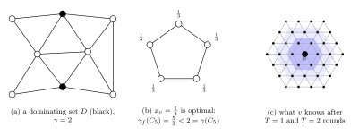
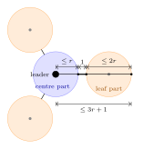
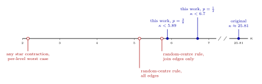
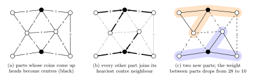

# Minimum Dominating Set on Planar Graphs: a smaller round exponent for optimal constant-round domination

This repository contains the paper (`paper/main.pdf`, with its LaTeX source in `paper/`),
machine-checked proofs (Lean 4 + Mathlib) and simulation code for an improvement of the
deterministic LOCAL $(7+\varepsilon)$-approximation of minimum dominating set on planar graphs
from [1].

## Background

**The problem.** A set $D$ of vertices of a graph $G$ is *dominating* if every vertex lies in $D$
or has a neighbour in $D$. The domination number $\gamma(G)$ is the minimum size of a dominating
set, and minimum dominating set (MDS) asks for one. Relaxing the integer program
$\min\sum_v x_v$ subject to $\sum_{u\in N[v]}x_u\ge 1$ for every $v$ from $x_v\in\{0,1\}$ to
$x_v\ge 0$ gives the fractional domination number $\gamma_f(G)\le\gamma(G)$.



MDS is NP-hard, even on planar graphs of maximum degree 3 [7]. It is a set cover problem whose
sets are the closed neighbourhoods $N[v]$. The greedy algorithm, which repeatedly adds a vertex that
dominates the most undominated vertices, therefore achieves ratio $1+\ln(\Delta+1)$ on graphs of
maximum degree $\Delta$ [8], and by the standard reduction from set cover, ratio
$(1-\varepsilon)\ln n$ is NP-hard [9]. Planar graphs are much easier: the layering technique of [10]
gives a polynomial-time $(1+\varepsilon)$-approximation for every fixed $\varepsilon>0$.

**Distributed setting.** In distributed computing the input graph is the network itself. Every
vertex is a processor that initially knows only its identifier and its neighbours, and it decides
whether it belongs to $D$ by exchanging messages with its neighbours. Dominating sets arise in this
form as cluster heads in wireless ad hoc and sensor networks, where every node needs a coordinator
within one hop and no node knows the whole topology.

In the LOCAL model [11], computation proceeds in synchronous rounds. In every round each vertex
sends a message of arbitrary size to each neighbour and performs arbitrary local computation. After
$T$ rounds a vertex knows exactly its radius-$T$ neighbourhood (panel (c) above). So a $T$-round
algorithm is a function from radius-$T$ neighbourhoods to outputs, and the number of rounds
measures how far a vertex has to look. A constant-round algorithm is local in the strongest sense:
- its running time does not depend on the size of the network;
- a change in the graph affects only the outputs within constant distance;
- on graphs of bounded degree it yields a sublinear-time algorithm that decides the output of a
  single vertex by exploring its neighbourhood [12].

### Standard distributed algorithms

**Parallel greedy.** The greedy algorithm adds one vertex at a time. Its direct distributed version
lets a vertex join when its *span*, the number of undominated vertices in its closed neighbourhood,
is the largest within distance 2. Then vertices that join in the same round do not compete for the
same undominated vertices. This can still take $\Omega(n)$ rounds, for example on a caterpillar
whose spine vertices have decreasing spans, because then only one vertex joins per round. The
algorithm of [15] removes this bottleneck by rounding spans up to powers of 2, so that many vertices
tie. Every round has three steps:
1. the vertices whose rounded span is maximal within distance 2 become candidates;
2. every undominated vertex counts the candidates that dominate it;
3. every candidate $v$ joins with probability $1/\mathrm{med}(v)$, where $\mathrm{med}(v)$ is the
   median of these counts over the undominated vertices that $v$ dominates.

The expected size of the result is $O(\log\Delta)\gamma(G)$, and the algorithm terminates in
$O(\log n\log\Delta)$ rounds with high probability.

**LP relaxation and rounding.** A fractional dominating set $x$ becomes a dominating set in two
rounds:
1. every vertex joins independently with probability $\min\lbrace 1,x_v\ln(\Delta+1)\rbrace$;
2. every vertex that is still undominated joins as well.

Since $\sum_{u\in N[v]}x_u\ge1$, a vertex remains undominated after step 1 with probability at most
$e^{-\ln(\Delta+1)}=1/(\Delta+1)$. Every vertex dominates at most $\Delta+1$ vertices, so
$n/(\Delta+1)\le\gamma_f(G)$, and the expected size is at most
$\ln(\Delta+1)\sum_v x_v+\gamma_f(G)$. In [13], covering and packing LPs are solved within a factor
$1+\varepsilon$ in $O(\log n/\varepsilon)$ rounds. Together with a rounding of this kind, this gives
an $O(\log\Delta)$-approximation of MDS in $O(\log n)$ rounds. In the same paper it was shown that
every polylogarithmic approximation, even a randomized one, needs
$\Omega(\min\lbrace\log\Delta/\log\log\Delta,\sqrt{\log n/\log\log n}\rbrace)$ rounds. So on general
graphs no constant-round algorithm has a constant ratio.

**Planar graphs in a constant number of rounds.** Sparse classes behave differently. The algorithm
of [14] has two steps:
1. every vertex $v$ whose open neighbourhood cannot be dominated by six vertices other than $v$
   joins $D$, which needs only the radius-2 neighbourhood of $v$;
2. every vertex that is still undominated adds a vertex of its closed neighbourhood that dominates
   the most undominated vertices.

It runs in six rounds and has ratio 130 on planar graphs [14]. Planarity enters only in the
analysis, which shows that step 1 selects fewer than $3\gamma(G)$ vertices outside a minimum
dominating set. This raised the question of the best ratio that a constant number of rounds can
achieve on planar graphs; see the Summary below for the answer.

**Cluster-and-solve.** Ratios close to the optimum need a global view of larger regions. Algorithms
of this kind on sparse classes [4, 3] work in three steps:
1. partition the graph into clusters of small radius such that few edges run between clusters;
2. let one vertex of every cluster collect the cluster and solve it exactly;
3. combine the local solutions.

The quality of the result depends on the weight of the edges between clusters, and the number of
rounds on the cluster radius. In [4], this gives a $(1+\varepsilon)$-approximation of MDS on planar
graphs in $O(\log^{\ast} n)$ rounds. A common way to build the clusters is repeated star contraction.
Every cluster picks a neighbouring cluster to merge with, such that the merges form vertex-disjoint
stars, and every star becomes one cluster. This at most triples the radius:



If every level multiplies the radius by 3 and the expected weight between clusters by $q$, then an
$\varepsilon$-fraction is reached after $L\approx\ln(1/\varepsilon)/\ln(1/q)$ levels. This takes
$3^L\approx(1/\varepsilon)^{\kappa}$ rounds with $\kappa=\ln 3/\ln(1/q)$, and this exponent is what
we improve.

## Summary

In [2] it was shown that no deterministic constant-round LOCAL algorithm approximates minimum
dominating set on planar graphs within $7-\varepsilon$. In [1] this bound was matched. For every
$\varepsilon>0$, the algorithm of [1] returns a dominating set of
size at most $(7+\varepsilon)\gamma_f(G)$ in

$$T_0 + O\big((c_0/\varepsilon)^{\kappa}\big) \text{ rounds},\qquad \kappa=\frac{\ln 3}{\ln(1/q)},\quad q=\frac{23}{24},\quad \kappa\approx 25.81 .$$

Open Problem 4 of [1] asks whether the exponent $\kappa$ can be substantially reduced.

We change one step of the clustering procedure of [1], a star contraction in the spirit of
[3, 4]: how the stars are chosen in Algorithm 1 (`RandomCluster`). Everything else carries over unchanged, including the radius recursion, the
view radius, the derandomization and the rounding. **For planar graphs the exponent drops from
25.81 to below 5.89.**

| analysis | per-level contracted fraction $f$ | exponent $\kappa=\ln 3/\ln\frac{1}{1-f}$ |
|---|---|---|
| [1] (heaviest-edge stars) | $1/24\approx 0.0417$ | $25.81$ |
| random centres, orientation bound (Thm 1), $p=3/8$ | $1935/12288\approx 0.1575$ | $<6.42$ |
| random centres, planar bound (Thm 2), $p=1/2$ (one fair coin, as in [1]) | $175/1152\approx 0.1519$ | $<6.7$ |
| random centres, planar bound (Thm 2), $p=3/8$ (three fair coins) | $357115/2097152\approx 0.1703$ | $5.88<\kappa<5.89$ |
| random centres, planar bound (Thm 2), $p=21/64$ (six fair coins) | $\approx 0.1718$ | $\approx 5.83$ |



Above the axis: proved exponents. Below the axis: the smallest exponent that each kind of analysis
can give (see [Limits of the approach](#limits-of-the-approach)).

$\kappa$ is the exponent of $1/\varepsilon$ in the number of rounds, so lowering it is a
polynomial speed-up. At $\varepsilon=0.01$, the term $(1/\varepsilon)^\kappa$ shrinks from about
$10^{52}$ to about $10^{12}$. Among algorithms whose number of rounds does not depend on $n$, the
algorithm of [1] is the only one known for target ratios in $(7,8]$, so this is the fastest known
such algorithm in that range.

In the other direction, the $(1+\varepsilon)$-approximations of [1] (fractional, and randomized with
expected size) need at least $1/\varepsilon-4$ rounds on every minor-closed class that contains all
paths ([Theorem 4](#theorem-4-a-lower-bound-on-the-dependence-on-ε)). On paths this is tight up to an
additive constant. On forests, $O(1/\varepsilon)$ rounds suffice for both
([Theorem 5](#theorem-5-forests-the-lower-bound-is-tight)), so there the answer is
$\Theta(1/\varepsilon)$. The same holds on all outerplanar graphs, with no bound on the degree
([Theorem 6](#theorem-6-outerplanar-graphs)).

## The rule

Fix a level $t$, and let $Q$ be the quotient graph of the current parts, weighted by the number of
edges between parts.

1. Every part becomes a **centre** independently with probability $p$. It reads $b$ fair coins of
   its leader, so $p=m/2^b$.
2. Every non-centre part that has a centre neighbour in $Q$ **joins its heaviest centre
   neighbour**. Ties are broken by identifier.
3. Each centre, together with the parts that joined it, forms one new part.



In this example the join edges carry weight 13. Two edges between leaves of the same star, of
weights 2 and 3, also become internal, so the weight between parts drops from 28 to 10.

The new parts are vertex-disjoint stars in $Q$, so the radius recursion $r_t=3r_{t-1}+1$ and the
round bound of [1] still hold. Every join edge becomes internal. Hence the cut weight drops by
at least

$$\mathrm{gain}(C)=\sum_{P\notin C}\ \max_{X\in C\cap N(P)} w(PX).$$

Write $s=1-p$ and $g(d)=1-s^d$.

## Results

### Theorem 1 (bounded out-degree orientation)

Suppose the edges of $Q$ can be oriented so that every vertex has out-degree at most $k$. Then

$$\mathbb{E}[\mathrm{gain}(C)]\ \ge\ f_k(p)\,w(Q),\qquad f_k(p)=\frac{(1-p)\big(1-(1-p)^k\big)}{k}.$$

In a proper minor-closed class of edge density $a$, such an orientation exists with
$k=\lceil a\rceil$ [5]. With $p=1/2$, we have $f_{\lceil a\rceil}(1/2)\ge 1/(8a)$, so the new
exponent is never worse than that of [1]. As the density grows, it becomes smaller by a factor
approaching 8 if $p\to0$ and $ap\to\infty$, for example with $p=2^{-j}$ and
$j=\lfloor\frac12\lfloor\log_2\lceil a\rceil\rfloor\rfloor$ fair coins per part and level. For a
fixed $p$ the factor tends to $8(1-p)$.

| density $a$ | [1] | ours, $p=1/2$ | ours, best dyadic $p$ | ratio |
|---|---|---|---|---|
| 1 | 8.23 | 3.82 | 3.82 | 2.15× |
| 2 | 17.02 | 5.30 | 5.14 | 3.31× |
| 3 (planar, via Theorem 1) | 25.81 | 6.97 | 6.42 | 4.02× |
| 6 | 52.18 | 12.84 | 10.08 | 5.17× |
| 10 | 87.34 | 21.44 | 14.81 | 5.89× |
| 100 | 878.34 | 219.18 | 115.67 | 7.59× |

Our exponents are rounded up, the ratios down. Every entry, and the choice of the best dyadic $p$, is
checked in Lean (`lean/Op4/Table.lean`).

The same substitution also improves the other guarantees of [1, Thm. 6.2] for every proper
minor-closed class:
- the deterministic $(1+\varepsilon)$-approximation of the fractional domination number;
- the randomized algorithm with expected size $(1+\varepsilon)\gamma$;
- the ratio $2a+1+\varepsilon$.

### Theorem 2 (sharper count for planar graphs)

Let $Q$ be a simple planar graph, and let $p\in[21/64,1]$. Then

$$\mathbb{E}[\mathrm{gain}(C)]\ \ge\ \varphi(p)\,w(Q),\qquad \varphi(p)=\frac{(1-p)\big(3-2(1-p)^3-(1-p)^6\big)}{9}.$$

$\varphi$ is maximized at $s^3=(\sqrt{37}-4)/7$, that is $p\approx 0.3324$, where
$\varphi\approx 0.17182$ and $\kappa\approx 5.827$.

**Proof idea.**

1. *Layer cake (exact).* Let $Q_\tau$ be the subgraph of edges of weight at least $\tau$, and let
   $d_\tau(P)$ be the degree of $P$ in it. Then
   $\mathbb{E}[\mathrm{gain}]=s\int_0^\infty\sum_P g(d_\tau(P))\,d\tau$. Every $Q_\tau$ is planar.
2. *Two degree facts.* Let $G$ be a simple planar graph with degrees $d_v$ and $n'$ non-isolated
   vertices. Then
   - (A) $|E|\le\sum_v\min(d_v,3)$;
   - (B) $2|E|\le\sum_v\min(d_v,6)+2n'$.

   Both follow from $e(H)\le 3|H|$ and from the bound for bipartite planar graphs.
3. *Pointwise certificate.* Let $a=(8g(3)-5g(6))/9$ and $b=(g(6)-g(3))/3$. Then for every $d\ge0$,
   $$g(d)\ \ge\ a\min(d,3)+b\big(\min(d,6)+2[d\ge1]\big),$$
   with equality at $d\in\{0,3,6\}$. Summing over all vertices and applying (A) and (B) gives
   $$\sum_v g(d_v)\ \ge\ (a+2b)\,|E|=\frac{3-2s^3-s^6}{9}\,|E|.$$
4. Integrate over $\tau$.

The count is optimal for its inputs. Over degree sequences constrained only by (A) and (B), the
infimum of $\sum_v g(d_v)/|E|$ is exactly $(3-2s^3-s^6)/9$, and the certificate is the dual
solution of that linear program.

### Theorem 3 (other classes)

Planarity enters Theorem 2 only through two density bounds. Let $\mathcal C$ be closed under taking
subgraphs, with every $H\in\mathcal C$ satisfying $|E(H)|\le a|V(H)|$, and every bipartite
$H\in\mathcal C$ satisfying $|E(H)|\le b|V(H)|$. Planar graphs have $a=3$ and $b=2$. Then for all
reals $t\ge a$ and $u\ge 2a$:
- $(A_t)$ $|E|\le\sum_v\min(d_v,t)$;
- $(B_u)$ $2|E|\le\sum_v\min(d_v,u)+b\,n'$.

**Theorem 3.** Suppose $\alpha_i,\beta_j\ge 0$ and thresholds $t_i\ge a$, $u_j\ge 2a$ satisfy
$g(d)\ge\sum_i\alpha_i\min(d,t_i)+\sum_j\beta_j(\min(d,u_j)+b[d\ge1])$ for every integer $d\ge0$.
Then on every simple $Q\in\mathcal C$,
$$\mathbb{E}[\mathrm{gain}(C)]\ \ge\ s\Big(\sum_i\alpha_i+2\sum_j\beta_j\Big)\,w(Q).$$

Theorem 2 is the case $t=3$, $u=6$, $b=2$. There are three consequences.

- **Density only.** With the single threshold $t=a$,
  $$\mathbb{E}[\mathrm{gain}]\ \ge\ s\cdot\min\big\lbrace g(\lfloor a\rfloor)/\lfloor a\rfloor,\ g(\lceil a\rceil)/a\big\rbrace\cdot w(Q).$$
  For integer $a$ this is Theorem 1. For non-integer $a$ it is strictly better.
- **Integer density is already optimal.** On $K_{k,n}$ the rule contracts at most $f_k(p)+1/n$ of
  the edges in expectation. All internal edges are counted here, since in a bipartite graph they are
  exactly the join edges. So on every class that contains all $K_{k,n}$, Theorem 1 is the true worst
  case of the rule. Examples are treewidth $\le k$ and, for $k\le5$, $K_{k+2}$-minor-free graphs [17].
  For instance, $K_5$-minor-free graphs have the same density 3 as planar graphs, but the rule
  cannot beat $\kappa\approx6.41$ on them. The planar improvement to 5.83 comes from excluding
  $K_{3,n}$, which is what $b=2$ records.
- **Surfaces.** A graph on a surface of Euler genus $e$ has at most $3n-6+3e$ edges, and at most
  $2n-4+2e$ if it is bipartite. For $e\le2$ this gives $a=3$, $b=2$, so Theorem 2 and all its
  numbers, including $\kappa<5.89$, hold verbatim on the projective plane, the torus and the Klein
  bottle. For larger genus:

| Euler genus $e$ | $a_e$ | $b_e$ | [1] | Thm 1 | density only | Thm 3 |
|---|---|---|---|---|---|---|
| 0, 1, 2 | 3 | 2 | 25.81 | 6.42 | 6.42 | 5.83 |
| 3 | 27/8 | 20/9 | 29.11 | 7.66 | 6.42 | 6.13 |
| 4 (double torus) | 11/3 | 12/5 | 31.67 | 7.66 | 6.97 | 6.55 |
| 6 | 21/5 | 30/11 | 36.36 | 8.88 | 7.66 | 7.19 |
| 8 | 51/11 | 3 | 40.20 | 8.88 | 8.19 | 7.75 |
| 12 | 11/2 | 24/7 | 47.79 | 10.08 | 9.19 | 8.76 |
| 20 | 33/5 | 70/17 | 57.46 | 11.28 | 10.60 | 10.10 |
| 100 | 27/2 | 8 | 118.10 | 19.45 | 18.73 | 18.17 |
| 200 | 37/2 | 11 | 162.04 | 25.18 | 24.50 | 23.93 |

The densities are $a_e=\max\lbrace 3,\max_n\min\lbrace(n-1)/2,\,3-(6-3e)/n\rbrace\rbrace$ and
$b_e=\max\lbrace 2,\max_n\min\lbrace\lfloor n^2/4\rfloor/n,\,2-(4-2e)/n\rbrace\rbrace$. Each entry is
the best $p$ with at most 8 fair coins, and our exponents are rounded up. Each certificate was found
by linear programming (`sim/tight/surfaces.py`) and is checked in Lean (`lean/Op4/Surfaces.lean`).

### Limits of the approach

- **This rule, join edges only.** Consider the Apollonian network obtained from $K_4$ by inserting
  a vertex into every face ten times (118,100 vertices). There, the expected join gain of the rule
  is at most $0.17402\,w$ for every $p$. Hence no analysis that counts only join edges gets this
  rule below $\kappa\approx 5.74$. Theorem 2 reaches $0.17182$. Checked in Lean
  (`lean/Op4/Apollonian.lean`), with planarity taken as given.
- **This rule, all internal edges.** Even counting edges between leaves of the same star,
  $K_{2,n}$ limits the rule to $1/(3\sqrt3)+1/n\approx 0.1925$ per level. So every analysis of this
  rule has $\kappa\ge 5.13$. Checked in Lean (`lean/Op4/Kkn.lean`).
- **Independent coins, join edges only.** Consider any rule with these two properties:
  - every part becomes a centre independently, with a probability that depends only on its
    weighted radius-$r$ neighbourhood and not on identifiers;
  - every non-centre joins some centre neighbour.

  Take the $m\times m$ triangular grid with unit weights. All vertices at distance more than $r+1$
  from the boundary have the same probability $p$, and so do their six neighbours. Such a vertex
  has a join edge with probability $s(1-s^6)$, where $s=1-p$, and every vertex has at most one join
  edge. The grid has $3m^2-O(m)$ edges, so the expected join weight is at most
  $\max_s s(1-s^6)/3+o(1)=2\cdot 7^{-7/6}+o(1)\approx 0.2066$ per level. Hence no analysis of such a
  rule that counts only join edges gets below $\kappa\approx 4.74$. Going further needs centre
  decisions that depend on each other. Checked in Lean (`lean/Op4/TriGrid.lean`).
- **Any star contraction, join edges only.** For every even $k\ge 2$ there is a triangulation with
  $n=4k$ vertices and domination number $\gamma=n/4$:
  1. take $k$ nested triangles $a_ib_ic_i$;
  2. join consecutive triangles by the six edges $a_ib_{i+1}$, $a_ic_{i+1}$, $b_ia_{i+1}$,
     $b_ic_{i+1}$, $c_ia_{i+1}$, $c_ib_{i+1}$;
  3. for every even $i$, insert one new vertex into each of the faces $a_ib_ic_{i+1}$ and
     $a_{i+1}b_{i+1}c_i$.

  These $k$ faces are disjoint and cover the $3k$ triangle vertices. So the closed neighbourhoods of
  the $k$ inserted vertices partition the vertex set, and $\gamma=k$. In any partition into stars,
  the centres and the singleton parts dominate the graph. So there are at least $\gamma$ parts, and
  at most $n-\gamma=3n/4$ vertices have a join edge. A triangulation has $3n-6$ edges, so for every
  star-selection rule, an analysis that counts only join edges gives at most a $1/4+o(1)$ fraction
  per level, that is $\kappa\ge\ln 3/\ln(4/3)\approx 3.819$. It was conjectured in [16] that every
  sufficiently large triangulation has $\gamma\le n/4$. If so, this is the best bound of this kind
  on triangulations. Checked in Lean (`lean/Op4/Nest.lean`), with planarity taken as given.
- **Any star contraction, per-level worst case.** On the square grid, a single level of star
  contraction internalizes at most a $2/5+o(1)$ fraction of the edges. So with radius growth 3, any
  analysis that bounds each level by its worst case has $\kappa\ge\ln 3/\ln(5/3)\approx 2.15$.
  Checked in Lean (`lean/Op4/Stars.lean`).

### Theorem 4 (a lower bound on the dependence on ε)

The deterministic $(1+\varepsilon)$-approximation of $\gamma_f$ and the randomized algorithm with
expected size $(1+\varepsilon)\gamma$ of [1] run in $(c_0/\varepsilon)^{\kappa}$ rounds. Open
Problem 3 of [1] asks for the optimal dependence on $\varepsilon$. For integral solutions on general
graphs, a $(1+\varepsilon)$-approximation of $\gamma$ needs $\Omega(\log n/\varepsilon)$ rounds [19].
The hard graphs lie in no proper
minor-closed class, since on every such class $f(\varepsilon)$ rounds suffice [1]. Paths give a
bound that is linear in $1/\varepsilon$.

**Theorem 4.** Let $r\ge 0$ and $L=2r+6+(r \bmod 3)$. Let $\mathcal A$ be an $r$-round LOCAL
algorithm that is either deterministic and outputs a fractional dominating set, or randomized and
always outputs a dominating set. Then for some identifier assignment on the path $P_L$, the
(expected) output size is at least $\gamma(P_L)+2/3=(1+2/L)\gamma_f(P_L)$. This holds even if
$\mathcal A$ knows the graph. Hence every $r$-round algorithm of either kind has ratio at least
$1+1/(r+4)$ on paths, and a $(1+\varepsilon)$-approximation needs at least $1/\varepsilon-4$ rounds.

*Proof idea.*
- Draw the identifiers uniformly at random. The expected output $x$ is a fractional dominating set.
- Vertices with isomorphic radius-$r$ balls get the same value. So $x$ is mirror-symmetric, and it
  takes one value $\mu\ge 1/3$ on the $M=4+(r\bmod 3)$ middle vertices, which see neither end.
- Let $R=r+1$ and $R+k=3t+2$ with $k\le 2$. The disjoint closed neighbourhoods
  $N[0],N[3],\dots,N[3t]$ give $\sum_{v<R}x_v+k\mu\ge (R+k+1)/3$.
- Hence $\sum_v x_v=2\sum_{v<R}x_v+M\mu\ge (L+2)/3$, while $\gamma(P_L)=\gamma_f(P_L)=L/3$.

Consequences:
- **Dichotomy.** Let $\mathcal C$ be a minor-closed class.
  - If $\mathcal C$ excludes some path, every component has bounded diameter, and a minimum
    dominating set is computable exactly in $O(1)$ rounds.
  - Otherwise $\mathcal C$ contains all paths, and the $(1+\varepsilon)$-approximations need at least
    $1/\varepsilon-4$ rounds.
  - For planar graphs, the optimal number of rounds is between $1/\varepsilon-4$ and
    $O((c_0/\varepsilon)^{5.83})$.
- **Tight on paths.**
  - Every fractional dominating set of $P_\ell$ has weight at least $\lceil\ell/3\rceil$.
  - On $P_\ell$ with $\ell\ge 2r+3$, put $x_v=2/3$ at the two ends and $x_v=1/3$ elsewhere. This
    gives weight $(\ell+2)/3\le(1+2/\ell)\lceil\ell/3\rceil$.
  - On a shorter path every vertex sees the nearer end. If it knows $\ell$, it outputs the average
    of a fixed minimum dominating set and its mirror image.
  - So for every $r\ge0$ an algorithm that knows the length has ratio at most $1+2/(2r+3)$. For
    $0<\varepsilon\le1$, the optimal number of rounds on paths is between $1/\varepsilon-4$ and
    $1/\varepsilon-1/2$. Both bounds are checked in Lean.
- **Exact values for $r\le 15$** (`sim/lower/path_sym.py`). The optimal ratio is $1+2/L$ when the
  length is known. Without the length it is $1+1/(r+2)$ for $r\not\equiv 2$ and $1+1/(r+3/2)$ for
  $r\equiv 2\pmod 3$.
- **Deterministic integral algorithms.** Paths already force ratio 3 in $O(1)$ rounds [1, Thm. 8.7],
  so the question does not arise for them.

### Theorem 5 (forests: the lower bound is tight)

For forests (density $a=1$), Theorem 1 gives $(c_0/\varepsilon)^{3.82}$ rounds. Linear in
$1/\varepsilon$ suffices, even with unbounded degrees.

**Theorem 5.** There is a constant $C$ such that for every $\varepsilon\in(0,1]$:
- a deterministic LOCAL algorithm computes, on every forest, a fractional dominating set of weight at
  most $(1+\varepsilon)\gamma_f$ in $C/\varepsilon$ rounds;
- a randomized LOCAL algorithm always outputs a dominating set of expected size at most
  $(1+\varepsilon)\gamma$ in $C/\varepsilon$ rounds.

With Theorem 4, the optimal number of rounds on forests is $\Theta(1/\varepsilon)$, both for the
deterministic fractional and for the randomized approximation.

*Proof sketch.*
1. **Repair.** Solve the problem on a vertex set $U$ in isolation. This costs at most the optimum's
   weight on $U$ plus one per vertex of $U$ with a neighbour outside $U$.
2. **Core and hairs.** The core $K$ is the set of vertices with two branches of height $\ge R$. It
   is connected in every component. Every other vertex hangs in a "hair" of depth $\le R$ at its
   nearest core vertex, and the components without core vertices have diameter less than $2R$.
   Every core vertex with at most one core neighbour has a path of $R$ vertices in its hair, so $R$
   times the number $L$ of these vertices is at most $3\gamma_f$. There are at most $3L$ branch
   vertices (core degree 0 or at least 3), and the core paths between them have at most $7L$ ends.
3. **Windows.** Work in the forest $G$ itself. For every position $i$ on a core path, including the
   $R$ positions beyond each end, the hairs of the path vertices within distance $R$ of $i$ form a
   window of weight $1/(2R+1)$. The hair of every branch vertex, and every core-free component, is a
   window of weight 1. Every vertex lies in windows of total weight 1. A window can be left only
   at its two ends on the core path or next to a branch vertex.
4. **Combine.** Average the optimal window solutions; take the unique optimum of least Euclidean
   norm, so no identifiers are needed. Counting the boundaries gives total weight at most
   $(1+72/R)\gamma_f$, and the output at $v$ depends only on its ball of radius $7R$. So
   $R=\lceil72/\varepsilon\rceil$ gives $7R\le511/\varepsilon$ rounds.
5. **Randomized version.** Compute an $O(1)$-approximate dominating set $D_0$ in $O(1)$ rounds
   [14], and contract its stars. The quotient $H$ is a forest with $N=|D_0|=O(\gamma)$ vertices.
   Take the core and the hairs in $H$; now $L\le N/R$. Every vertex of a core path draws a random
   value and picks as its anchor the vertex of smallest value within distance $R$ on its core path.
   Cut the core paths between vertices with different anchors, and at the branch vertices. An edge
   is cut with probability at most $2/(R+2)$, and every cluster has radius at most $2R+1$. Then
   solve each cluster exactly.

The deterministic part is machine-checked, and so are the size bound, the cut probability and the
dependence on the coins in the randomized part ([below](#machine-checked-proofs-lean)).

The proof uses forests only to build windows of radius $O(R)$ and weighted boundary
$O(\gamma_f/R)$ locally.
Such windows for planar graphs, with no dependence on $n$ or on the maximum degree, would give
$\Theta(1/\varepsilon)$ on planar graphs as well. Star contractions give radius
$(c_0/\varepsilon)^{\kappa}$.

### Theorem 6 (outerplanar graphs)

**Theorem 6.** There is a constant $C$ such that for every $\varepsilon\in(0,1]$, on every outerplanar
graph:
- a deterministic LOCAL algorithm computes a fractional dominating set of weight at most
  $(1+\varepsilon)\gamma_f$ in $C/\varepsilon$ rounds;
- a randomized LOCAL algorithm always outputs a dominating set of expected size at most
  $(1+\varepsilon)\gamma$ in $C/\varepsilon$ rounds.

With Theorem 4, the optimal number of rounds for both approximations on outerplanar graphs is
therefore $\Theta(1/\varepsilon)$, with no dependence on the maximum degree. On arbitrary graphs of
maximum degree $\Delta$, $O(\varepsilon^{-4}\log^2\Delta)$ rounds are known [20]. In a constant
number of rounds, the best ratio of a deterministic algorithm that outputs a dominating set of an
outerplanar graph is 5 [18].

*Proof sketch.* Several steps use the packing bound: if the closed neighbourhoods of the vertices of
a set $A$ are pairwise disjoint, then $\gamma_f\ge|A|$.
1. **Faces.** The inner faces are exactly the induced cycles, and they are isometric. Faces with at
   most $\ell=\Theta(R)$ vertices are seen locally; longer faces ("holes") are not.
2. **Decomposition graph.** Its nodes are the short faces, the edges on no short face, and the
   vertices where several pieces meet. The bags of adjacent nodes meet in one vertex or one edge. By
   Euler's formula, the cycle rank of this graph $D$ is exactly the number $h$ of holes. Far apart
   vertices on the holes give $h\le3\gamma_f/(\ell-13)$.
3. **Unfolding.** The universal cover of $D$ is a tree $T$. Gluing the bags along $T$ gives a
   covering graph $\hat G$ of $G$, and $T$ is a tree decomposition of $\hat G$. Every hole unrolls
   into an infinite path. A ball of radius $r$ in $\hat G$ is computed from the ball of radius
   $r+\ell$ in $G$.
4. **Runs.** Take the core and the hairs of Theorem 5 on $T$, with heights measured in $\hat G$. On a
   core path, the edges $e_i$ have adhesions $X_i$, and the indices $i$ with $v\in X_i$ form an
   interval, the run of $v$. A vertex of high degree can have a long run. The edge $e_i$ gets the
   length $1/\rho_i$ plus half the distances across the bags at its two ends, where $\rho_i$ is the
   length of the shortest maximal run through $i$. So the many edges along a run of a high-degree
   vertex are short, and still $d(X_a,X_b)$ is at most twice the length from $e_a$ to $e_b$ plus 3.
5. **Windows.** The windows on a core path are the bands of length $R$, one for every real shift,
   with weight $d\tau/R$. With the windows at branch nodes and the core-free components, every node
   has total weight 1, and every window has radius $O(R+\ell)$. Every vertex averages the optimal
   window solutions at one of its lifts, and the result does not depend on the lift.
6. **Cost.** Each window solves its problem on its closed neighbourhood, so a cut edge costs at most
   its adhesion, with no degree factor. The packing bound also gives $O(\gamma_f/R)$ ends of the
   core, and $O(\gamma_f)$ for the total length of the core paths: every twelfth maximal run carries
   a vertex whose closed neighbourhood stays between its neighbours, and long distances across a bag
   contain far apart vertices. With $\ell=R+13$ the excess is at most $430\gamma_f/R$, and every
   vertex computes its value from its ball of radius $15R+88$ in $G$.
7. **Randomized version.** Take $\ell=6R+5$, and cut the core-path edges of length more than $R$.
   Every edge of $D$ gets an exponential clock with rate equal to its length, shared by all its
   lifts. Every core-path node picks as its anchor the edge of smallest clock within distance $R$, and
   the core is cut between different anchors. Distinct lifts are more than $3R$ apart along a core
   path, so the clocks that matter are independent. In expectation, at most $242\gamma_f/R$ edges
   of $D$ are cut, and every cluster has radius $O(R)$.

The run lemmas, the branch count, the interval facts of step 7 and the arithmetic of all constants
are machine-checked, with the structure of the covering graph as hypotheses
([below](#machine-checked-proofs-lean)).

## Plugging the rule into the algorithm of [1]

Numbering refers to [1]. In Algorithm 1 (`RandomCluster`), lines 6–13 are replaced by the rule
above.

- **Lemma 4.1** (partition, radius, dependence on coins). The proof only uses that the new parts are
  vertex-disjoint stars whose leaves are adjacent to their centre in $Q$.
- **Lemmas 4.2 and 4.3.** Fix the coins of earlier levels. Then $Q$ is a fixed simple planar graph,
  and the centre events are independent. Theorem 2 gives
  $\mathbb{E}[\mathrm{cut}_t\mid\mathcal F_{t-1}]\le(1-\varphi(p))\,\mathrm{cut}_{t-1}$, and
  Theorems 1 and 3 give the analogous bounds for other classes. Corollary 4.4 follows verbatim, and
  Lemma 4.2 is no longer needed.
- **Lemma 4.5** (view radius $\rho_t=2(3^t-1)$) is unchanged. The new part of a vertex is
  determined by the centre status and the join choices of the parts that the same view reveals.
- **Theorem 5.4** keeps the round bound $T_{\mathcal C}+9\cdot 3^L$. It uses $bL$ fair coins per
  vertex instead of $L$.
- **Theorem 6.1** (the derandomization of [6]) needs only a fixed finite number of fair coins per
  vertex, which still holds.
- **Theorem 6.2 and Corollary 8.1** hold with $q'=1-\varphi(p)$:
  - $p=3/8$ gives $q'=1740037/2097152$;
  - $p=1/2$ gives $q'=977/1152$;
  - $p=21/64$ gives $q'=3642429005643/2^{42}$.

## Machine-checked proofs (`lean/`)

Lean 4 (`leanprover/lean4:v4.36.0-rc1`) with Mathlib; the exact Mathlib revision is pinned in
`lean/lake-manifest.json`. Every theorem below depends only on the standard axioms (`propext`,
`Classical.choice`, `Quot.sound`). There is no `sorry`.

The random centre set is modelled exactly: `E p A f` is the expectation of `f D` over a random
subset `D ⊆ A` that contains each element independently with probability `p`.

`lean/Op4/RandomCentres.lean` (Theorem 1):
- `gain_eq_join_edges`: the gain is the weight of a set of pairwise distinct edges.
- `vertex_bound`: $|A|\cdot\mathbb{E}[\max_{x\in C_A}w(x)]\ge g(|A|)\sum_{x\in A}w(x)$.
- `random_centres`: Theorem 1, with the orientation as a hypothesis. `arcs_eq_half_total` shows
  that for an orientation, the arc sum equals $w(Q)$. `Orientation.lean` removes the hypothesis.
- `f_three_eighths`, `f_le`: $f_3(3/8)=1935/12288$, and $f_3\le 63/400$ for every $p$.
- `kappa_new`, `kappa_paper`, and the related exponent bounds: $6.4<\kappa'<6.42$ and
  $25<\kappa_{\mathrm{AS}}<26$.

`lean/Op4/Sharper.lean` (Theorem 2):
- `sharper`: Theorem 2, in a discrete form of the layer cake. The proof is by induction on the
  support: subtract the smallest positive weight $t$ from every edge, and the gain splits into $t$
  times the join indicator plus the gain of the remaining weights.
- `degree_lemma`: the degree inequality, derived from (A), (B) and a pointwise certificate.
- `cert_three_eighths`, `cert_half`: the certificates for $p=3/8$ and $p=1/2$.
- `cert_range`: the certificate for every $p\in[21/64,1]$, with $a=(1-s^3)(3-5s^3)/9$ and
  $b=(s^3-s^6)/3$ for $s=1-p$, so that $a+2b=(3-2s^3-s^6)/9$.
- `sharper_range`: Theorem 2 for every $p\in[21/64,1]$.
- `f_sharper`, `f_sharper_half`: $\varphi(3/8)=357115/2097152$ and $\varphi(1/2)=175/1152$.
- `kappa_sharper`, `kappa_sharper_half`: $5.88<\kappa'<5.89$, and $\kappa'<6.7$ for $p=1/2$.
- `phi_six_coins`, `kappa_six_coins`: $\varphi(21/64)=755617505461/2^{42}$ and $5.82<\kappa'<5.83$.
- `sharper_core`: the layer-cake core. A degree inequality on every support subgraph gives the
  per-level bound. `sharper` is this core plus `degree_lemma`.

`lean/Op4/General.lean` (Theorem 3):
- `general`: Theorem 3, for finitely many real thresholds.
- `degree_lemma_gen`: its degree inequality, from the facts $(A_t)$, $(B_u)$ and a certificate.
- `aonly`, `cert_aonly`: the density-only bound
  $s\cdot\min\lbrace g(\lfloor a\rfloor)/\lfloor a\rfloor,\ g(\lceil a\rceil)/a\rbrace$.

`lean/Op4/Orientation.lean` (the orientation theorem of [5]):
- `orientation_of_density`: if every vertex set $S$ spans at most $k|S|$ edges, there is an
  orientation with out-degree at most $k$. The proof is Hall's theorem: every edge is matched to
  one of $k$ copies of one of its endpoints.
- `random_centres_density`: Theorem 1 with the orientation replaced by this density bound.

`lean/Op4/Density.lean` (the facts from the density bounds):
- `DensityA a w`: every vertex set $S$ spans at most $a|S|$ edges of the support of $w$.
  `DensityB b w`: for disjoint $S$ and $T$, at most $b(|S|+|T|)$ support edges join $S$ to $T$.
  Both pass to every weighting whose support lies in that of $w$ (`densityA_mono`, `densityB_mono`).
- `facts_of_density`: the facts $(A_t)$ for $t\ge a$ and $(B_u)$ for $u\ge 2a$ of Theorem 3.
  `planar_facts`: the facts (A) and (B) of Theorem 2, from $a=3$ and $b=2$.
- `general_density`, `sharper_range_density`: Theorem 3, and Theorem 2 for every
  $p\in[21/64,1]$, from the density bounds of $w$ alone.
- `random_centres_densityA`: Theorem 1 from `DensityA k w` alone.

`lean/Op4/Surfaces.lean` (surface table): for every Euler genus $e\ge3$ in the table,
- `cert_genus`$e$: the certificate of Theorem 3 at the table's $p$, for every degree;
- `thresholds_genus`$e$: its thresholds satisfy $t\ge a_e$ and $u\ge 2a_e$;
- `surface_genus`$e$: the per-level bound under `DensityA` $a_e$ and `DensityB` $b_e$, obtained
  from `general_density`;
- `kappa_genus`$e$: the exponent bound in the last column.

The densities $a_e$ and $b_e$ come from Euler's formula on the surface.

`lean/Op4/Asymptotic.lean` (the factor 8):
- `expRatio_tendsto_eight`: the exponent of [1] divided by ours tends to 8 for every $p(a)$ with
  $p\to0$ and $ap\to\infty$.
- `expRatio_tendsto_const`: for a fixed $p\in(0,1]$ the ratio tends to $8(1-p)$.
- `dyadic_p`: $p=2^{-j}$ with $j=\lfloor\frac12\lfloor\log_2\lceil a\rceil\rfloor\rfloor$ satisfies
  both conditions.
- `never_worse`: with $p=1/2$ our exponent is at most that of [1] for every $a\ge1/2$.

`lean/Op4/Table.lean` (the density table and the six-coin remark), generated from exact rational
data by `lean/scripts/gen_table.py`:
- `table_as_`$a$, `table_half_`$a$, `table_best_`$a$ for $a=1,2,3,6,10,100$: the exponent of [1]
  to two decimals, and ours for $p=1/2$ and for the best dyadic $p$, rounded up.
- `best_dyadic_`$a$: the printed $p$ maximizes $f_a(p)$ among all $p=j/256$, that is, among all
  $p$ with at most 8 fair coins.
- `table_factor_`$a$: the ratio, rounded down.
- `six_coins_near_best`: for every $p\le1$ with a positive fraction, the six-coin exponent of
  Theorem 2 exceeds the exponent at $p$ by less than $10^{-3}$.

`lean/Op4/Kkn.lean` (integer density is optimal for the rule):
- `internal_subset`: in a graph without triangles, every edge inside a star is a join edge.
- `E_joins`: a vertex of degree $d$ joins a star with probability $(1-p)(1-(1-p)^d)$.
- `kkn_internal`: on $K_{k,n}$ with unit weights, for every $p\in[0,1]$ and every choice among the
  (equally heavy) centre neighbours, the expected number of internal edges is at most
  $(f_k(p)+1/n)\,|E|$.
- `kkn_optimal`: hence no analysis of the rule gives a per-level fraction above $f_k(p)$ on a class
  that contains all $K_{k,n}$.
- `kkn_planar`: for $k=2$ the fraction is at most $\max_pf_2(p)=1/(3\sqrt3)$ (`f_two_le`,
  `f_two_max`), so the exponent is above $5.13$. That $K_{2,n}$ is planar is taken as given.

`lean/Op4/Exact.lean` (the dichotomy, first part):
- `exact_min`: every vertex outputs its membership in a fixed minimum dominating set of its
  component, and the output is a minimum dominating set of $G$.
- `exact_local`: if neither $G$ nor $G'$ has a path on $k$ vertices and the two graphs agree within
  distance $k$ of $v$, the outputs at $v$ are equal. So $k$ rounds suffice.
- `exact_on`: the same on a network whose identifiers that are not nodes are isolated vertices.

`lean/Op4/Apollonian.lean` (the Apollonian network):
- The construction: a face at level $j$ is addressed by a face of $K_4$ and a word in
  $\lbrace 0,1,2\rbrace^j$, and child $k$ replaces corner $k$ by the inserted vertex.
  `apo_degree`: after $t$ steps the vertices of $K_4$ have degree $3\cdot2^t$ and a vertex inserted
  at level $j$ has degree $3\cdot2^{t-j-1}$.
- `apo_card`, `apo_edges`: for $t=10$ there are $118100$ vertices and $354294$ edges.
- `apo_join_le`, `apo_optimal`: for every $p\le1$ the expected join gain with unit weights (the
  number of vertices that join a star) is at most $0.17402\,|E|$, by a polynomial certificate.
- `apo_join_three_eighths`: at $p=3/8$ it is $0.17161\,|E|$ to five decimals, against
  $\varphi(3/8)=0.17029$ (`phiP_three_eighths`).
- `apo_kappa`: a per-level fraction $\varphi\le0.17402$ has $\kappa>5.74$.

`lean/Op4/Stars.lean` (star contractions on the square grid):
- `card_joinE_add_le`: in a partition into stars the centres dominate. So if every dominating set
  has at least $\gamma$ vertices, at most $n-\gamma$ vertices have a join edge.
- `card_internalE_le`: in a graph without triangles and with maximum degree $\Delta$, at most
  $\Delta n/(\Delta+1)$ edges lie inside a star.
- `grid_internal`, `grid_optimal`, `grid_kappa`: the square grid $P_m\square P_m$ has $2m(m-1)$
  edges (`grid_edges`), and no star contraction makes more than $4m^2/5$ of them internal. So a
  per-level fraction $\varphi$ that holds on all square grids has $\varphi\le 2/5$, and
  $\kappa>2.15$.

`lean/Op4/Nest.lean` (nested triangles):
- `nest_edges`: for even $k$ the graph has $n=4k$ vertices and $12k-6=3n-6$ edges. That it is a
  planar triangulation is taken as given.
- `nest_gamma`, `nest_dominate`: its domination number is $k$.
- `nest_join`: every partition into stars has at most $3k$ join edges.
- `nest_optimal`, `nest_kappa`: so a per-level fraction $\varphi$ of join edges that holds on all
  these graphs has $\varphi\le 1/4$, and $\kappa>3.818$.

`lean/Op4/TriGrid.lean` (identifier-free rules on the triangular grid):
- The model: on the $m\times m$ triangular grid, part $P$ becomes a centre independently with
  probability $\rho(w_P)$, where $w_P$ records which positions at offsets in $[-r,r]^2$ exist. This
  window contains the radius-$r$ ball, so the model covers every identifier-free rule of radius $r$
  with unit weights. The rule may depend on $m$, and the choice of a centre neighbour is arbitrary.
- `EQ_joins`: with independent coins of probabilities $q$, a vertex joins a star with probability
  $(1-q_P)(1-\prod_{X\in N(P)}(1-q_X))$.
- `tri_edges`: the grid has at least $3m^2-12(r+1)m$ edges.
- `idfree_joins`: the expected number of join edges is at most $0.61974\,m^2+4(r+1)m$, using
  $\max_{s\in[0,1]}s(1-s^6)\le 0.61974$ (`s_one_sub_le`).
- `idfree_optimal`, `idfree_kappa`: so a per-level fraction $\varphi$ of join edges that holds on
  all these grids has $\varphi\le 0.20658$, and $\kappa>4.74$.

`lean/Op4/PathLower.lean` (Theorem 4):
- `path_excess`: every fractional dominating set of $P_{2R+M}$ with $M\ge 4$ that is constant on the
  $M$ middle vertices and invariant under reflection has weight at least $(2R+M)/3+2/3$.
- `left_sum`: the disjoint closed neighbourhoods $N[0],N[3],\dots,N[3t]$ give weight at least $t+1$
  on $\lbrace 0,\dots,3t+1\rbrace$.
- `path_gamma`: $\gamma(P_{3m})=\gamma_f(P_{3m})=m$. The vertices $1,4,\dots,3m-2$ dominate, and every
  fractional dominating set has weight at least $m$.
- `path_lower`: for $L=2r+6+(r\bmod 3)$, $3$ divides $L$, the weight is at least
  $(1+2/L)\gamma_f(P_L)$, and $1+2/L\ge 1+1/(r+4)$.
- `rounds_lower`: ratio $1+\varepsilon$ forces $r\ge 1/\varepsilon-4$.

`lean/Op4/LocalPath.lean`, `lean/Op4/LocalRandom.lean` and `lean/Op4/LocalMeasure.lean` (Theorem 4
in the LOCAL model): the symmetrization over identifiers.
- The model: the view of a vertex after $r$ rounds lists the identifiers and the degrees of the
  vertices at offsets $-r,\dots,r$, with `none` outside the path; for randomized algorithms it also
  lists their coins. The coins are independent and identically distributed on an arbitrary
  probability space, and independent of the identifiers. An algorithm is a function of the view
  that does not change when the view is read backwards, and it may depend on $L$, $r$ and the size
  of the identifier space. For randomized algorithms the output at a vertex must be integrable in
  the coins (for instance, measurable and bounded).
- `local_path_lower` (deterministic), `measure_path_lower` (randomized): if the output is a
  fractional dominating set for every injective identifier assignment (and every outcome of the
  coins), some assignment gives (expected) weight at least $(1+2/L)\gamma_f(P_L)$.
- `local_ratio`, `measure_ratio`, `local_rounds_lower`, `measure_rounds_lower`: ratio at least
  $1+1/(r+4)$, and ratio $1+\varepsilon$ forces $r\ge 1/\varepsilon-4$.
- `random_path_lower`, `random_ratio`, `random_rounds_lower`: the same for coins with finitely many
  values, with finite sums instead of integrals.
- `family_lower`: the averaging step, for any family of fractional dominating sets that transforms
  under the reflection and the shift like the output of a local algorithm.

`lean/Op4/PathUpper.lean` (the upper bound on paths, in the same model):
- `path_lower_ceil`: every fractional dominating set of $P_L$ has weight at least $\lceil L/3\rceil$.
- `local_path_upper`: for every $r\ge0$ and $L\ge1$ there is an algorithm that knows $L$, reads
  from the view only the distance to the nearer end (capped at $r+1$), and outputs for every
  injective identifier assignment a fractional dominating set of weight at most
  $(1+2/(2r+3))\,y(P_L)$ for every fractional dominating set $y$ of $P_L$.
- `local_rounds_upper`: for $0<\varepsilon\le1$, some $r\le 1/\varepsilon-1/2$ gives ratio
  $1+\varepsilon$.

`lean/Op4/Levels.lean` (from the per-level factor to the exponent):
- `levels`: if $c_{t+1}\le q\,c_t$ and $x\ge1$, then $L=\lceil\log x/\log(1/q)\rceil$ levels give
  $c_L\le c_0/x$ and $3^L\le 3x^{\kappa}$ with $\kappa=\ln 3/\ln(1/q)$.

`lean/Op4/Windows.lean` (the steps of Theorems 5 and 6 that do not depend on the graph class), for
finite graphs:
- `packing`: if the closed neighbourhoods of the vertices of $A$ are pairwise disjoint, every
  fractional dominating set has weight at least $|A|$.
- `repair`: let $B$ meet $N[u]$ for every $u\in U$ with a neighbour outside $U$. A vector $y\ge0$
  that dominates $U$, restricted to $U$, plus weight 1 on $B$ dominates $U$ and has weight
  $y(U)+|B|$. This is the repair inequality of Theorem 5, and on the finite graph induced by $N[W]$
  the feasibility claim in the repair step of Theorem 6.
- `window_average`: if windows cover every vertex with total weight exactly 1, and every window has
  a solution that dominates it and is optimal among the vectors supported on a set containing the
  window and its $B$, the weighted average is a fractional dominating set of weight at most
  $y(V)+\sum_W\mathrm{wt}(W)|B_W|$ for every fractional dominating set $y$.

`lean/Op4/ForestBasic.lean` to `lean/Op4/ForestLocal.lean` (Theorem 5, deterministic part), on
every finite forest $G$ and for every $R\ge1$, following the proof sketch above. The core vertices
with one or two core neighbours lie on the core paths; the others are the branch vertices.
- `ForestCore.lean`: the core and the hairs. The core is convex (`core_convex`), a vertex reaches
  its nearest core vertex by a path of length at most $R$ (`proj_length_le`), that vertex is unique
  (`proj_unique`), and the components that miss the core have diameter less than $2R$
  (`dist_lt_of_no_core`).
- `cover`: the windows are the hairs of the vertices of a core path within distance $R$ of one of
  its vertices (weight $1/(2R+1)$), the same within distance $R-t$ of an end, for every direction in
  which the core path stops there and every $1\le t\le R$ (weight $1/(2R+1)$), the hair of every
  branch vertex (weight 1), and every core-free component $C$, once per vertex (weight $1/|C|$).
  Every vertex lies in windows of total weight exactly 1. On a core path $p_1\dots p_m$ these are the
  sets $\{p_j:|j-i|\le R\}$ for $1-R\le i\le m+R$ (`cover_count`).
- `card_L_le`: $R$ times the number of core vertices with at most one core neighbour is at most
  $3y(V)$.
- `sum_wt_wB_le`: the windows have total weighted boundary at most $(72/R)\,y(V)$, for every
  $y\ge0$ that dominates the vertices that reach the core.
- `exists_isOpt`: every window problem has an optimal solution, by compactness; `locOpt` fixes one.
- `forest_frac`: the average `forestSol G R` of these solutions is a fractional dominating set of
  weight at most $(1+72/R)\,y(V)$ for every fractional dominating set $y$.
- `forest_frac_on`: in the LOCAL model, the vertex type is the identifier space, and the identifiers
  that are not nodes are isolated vertices. Then on the node set $S$ the weight is at most
  $(1+72/R)\,y(S)$ for every $y\ge0$ that dominates the nodes.
- `forest_local`: if every vertex at distance less than $7R$ from $v$ has the same neighbours in
  $G$ and in another forest $G'$, the outputs at $v$ are equal. So the output is computed in $7R$
  rounds, and $R=\lceil72/\varepsilon\rceil$ gives the deterministic part of Theorem 5 with
  $C=511$.

`lean/Op4/ForestRand.lean` (Theorem 5, randomized part), on every finite forest $G$ and for every
$R\ge1$. The input of [14] is a hypothesis: a set $D_0$ and stars $d$ with $d(u)\in D_0\cap N[u]$
and $d=\mathrm{id}$ on $D_0$. The coins are independent real values with any atomless law; ties
have probability 0 and are broken by a fixed index.
- `quot_acyclic`: the contraction $H$ of the stars is a forest.
- `prob_anchor_ne`: two adjacent vertices of a core path get different anchors with probability at
  most $2/(R+2)$.
- `card_outC_le`: for every set $C$ of cut edges, solving every cluster exactly gives at most
  $|D^*|+2|C|$ vertices, for every dominating set $D^*$.
- `cl_shape`, `cl_core_path`: the clusters are those of the proof sketch; `cluster_radius`: every
  cluster has radius at most $2R$ in $H$.
- `forest_rand`: the output always dominates, and its expected size is at most $|D^*|+16|D_0|/R$.
  `forest_rand_approx`: if $|D_0|\le c_0\gamma$ and $R\ge 16c_0/\varepsilon$, the expected size
  is at most $(1+\varepsilon)\gamma$.
- `randOut_local_G`: whether $v$ is in the output depends only on the coins within distance
  $15R+1$ of $v$ in $G$.

`lean/Op4/Outer.lean` (Theorem 6, the combinatorial steps). The structure of the covering graph
enters as hypotheses.
- `CorePath`: a core path with adhesions $X_i$, each one vertex or one edge, in which the indices of
  every vertex form an interval, its run. `ofGraph` builds one with the distance of a connected
  graph.
- `R1`, `R2_upper`, `R2_lower`, `R3`: the run lemmas. Adhesions at maximal runs $I_c$ and $I_{c'}$
  with $c'\ge c+3$ are disjoint. If $k$ maximal runs meet $[a,b]$, then
  $(k-4)/2\le\sum_{i=a}^b1/\rho_i\le k$. And $d(X_a,X_b)\le2\sum_{i=a}^b\mu(e_i)+3$.
  `window_radius`: a path window of length at most $R$ keeps its adhesions within distance $2R+3$
  of the first one. `window_weight`: with weight $d\tau/R$ every node has total weight 1.
- `branch_count`, `branch_neighbours`: in a finite graph,
  $\sum_{\deg v\ge3}(\deg v-2)\le2\,\mathrm{rk}+\#\lbrace v:\deg v=1\rbrace$, so the nodes of
  degree other than 2 have at most $6\,\mathrm{rk}+4\#\lbrace v:\deg v=1\rbrace$ neighbours.
- `big_left`, `big_right`, `card_symmDiff_le`, `anchor_cuts`: the interval facts of the randomized
  version. If $B(p)\not\subseteq B(p')$, then $\mu(B(p))>R$. Every edge lies in
  $B(p)\triangle B(p')$ for at most two edges $pp'$ of a segment. So on a finite segment the ratios
  $\mu(B(p)\triangle B(p'))/\mu(B(p)\cup B(p'))$ sum to at most $2\sum_f\mu(f)/R$. That these
  ratios are the cut probabilities (the race of exponential clocks), and the same count over one
  period of an infinite segment, are not formalized.
- `few_holes`, `cycle_packing`: $h(\ell-13)/3\le\gamma_f$ from the packing sets, and the packing
  on an isometric cycle.
- `sum_mu_le`, `cut_weight_le`, `det_cut_le`, `det_excess`, `rand_cut_le`, `rand_size`: the
  constants of the proof from its per-step bounds, taken as hypotheses. They give
  $\sum\mu\le75\gamma_f+178(4h+2N_1)$, at most $215\gamma_f/R$ for the windows and an excess of
  at most $430\gamma_f/R$ for $R\ge1500$, and at most $242\gamma_f/R$ expected cut edges and expected
  size at most $\gamma+968\gamma/R$ for $R\ge2200$.

**Taken as given.** The classical edge bounds from Euler's formula enter as the hypotheses
`DensityA` and `DensityB` (planar: $a=3$, $b=2$; surfaces: $a_e$, $b_e$). Results of other papers
are not formalized: the algorithm of [1] and its analysis, into which the rule is plugged, except
for the step in `Levels.lean`.

**Not formalized.**
- In the randomized part of Theorem 5: that the core, the anchors and the clusters are computed
  from balls of radius $O(R)$ in $G$ (only the dependence on the coins is checked), and the
  computation of $D_0$ in $O(1)$ rounds [14].
- In Theorem 6: the faces and the decomposition graph, the covering graph and its group action,
  the core, the hairs and the windows on it, the separation arguments behind the packing bounds,
  the averaging over orbits with continuous weights and on infinite core paths, the exponential
  clocks, and the locality and round count. `Outer.lean` checks the steps between them, with these
  as hypotheses.
- The scripts in `sim/lower/` check the constructions of Theorems 5 and 6 numerically.

Build:

```sh
cd lean
lake exe cache get   # download prebuilt Mathlib
lake build
```

## Simulations and numerical checks (`sim/`)

Requires Python 3 with `numpy` and `scipy`, and `networkx` for `sim/lower/outer_cover.py`.

- `sim/rules.py`: one level of contraction under several star-selection rules on planar families
  (Delaunay triangulations, triangular and square grids, $K_{2,n}$, stacked triangulations, cubic
  graphs, adversarial weightings). Run as `python3 rules.py [seed] [adv]`.
- `sim/levels.py`: the original heaviest-edge selection of [1] and rank-based variants.
- `sim/mpx.py`: one-shot local clustering by capped exponential shifts. This is a negative
  result: it cuts a constant fraction of the edges on a "tree ladder" for every radius.
- `sim/tight/cert.py`: exact rational check of the certificate at $p=3/8$ and $p=21/64$, and of
  the resulting exponents.
- `sim/tight/deglp.py`: the degree-only linear program under (A) and (B), whose optimum equals
  $(3-2s^3-s^6)/9$.
- `sim/tight/apo.py`: the Apollonian limit for join-edge analyses.
- `sim/tight/sanity.py`: checks (A), (B) and the degree inequality on many planar graphs and random
  subgraphs.
- `sim/tight/surfaces.py`: Theorem 3 on surfaces. For each Euler genus it finds the certificate by
  linear programming, checks it in exact rational arithmetic, and prints the table above.
- `sim/lower/tree_frac.py`: Theorem 5, deterministic part. It runs the window averaging, with the
  windows of the proof, on paths, caterpillars, spiders, brooms, binary and random trees. It asserts
  that the windows have weight 1, that the output dominates, that the excess over $\gamma$ is at most
  the weighted boundary $B$, and that $B\le72\gamma/R$. The measured values are at most
  $0.47\gamma/R$ for the excess and $2.9\gamma/R$ for $B$.
- `sim/lower/tree_ldd.py`: the randomized forest clustering by anchors. It measures the cut (at
  most about $1.0n/R$) and asserts that every cluster has radius at most $2R+1$.
- `sim/lower/outer_frac.py`: Theorem 6. It covers rings, chains of holes, random outerplanar graphs
  of maximum degree 3, 4 and 6, and graphs with vertices of degree up to 320: fans, strips of
  alternating fans, Farey graphs, a hole with large fans glued to its outside, and random graphs
  that attach new faces preferentially at vertices of high degree. It works in $G$ itself, on graphs
  whose holes are longer than all windows. For $R\in\{4,8,16\}$, it asserts that the windows have
  weight 1, that the averaged solution dominates, and that the excess is at most the repair bound.
  That bound stays below $19\gamma_f/R$, independently of the maximum degree, against
  $430\gamma_f/R$ in the proof. For the randomized version, it samples the long and the anchor cuts.
  Their expected number stays below about $1.1$ times the total core-path length over $R$, against
  3 times in the proof.
- `sim/lower/outer_cover.py`: Theorem 6 as in the proof. It builds the universal cover $T$ of the
  decomposition graph and the covering graph $\hat G$, and runs both versions on them. It checks
  the intermediate claims one by one: the faces, the cycle rank of $D$, the separators and the
  packing behind the bound on the number of holes, (i) to (iii), (b) to (d), (R1) to (R3), the
  packing sets behind the bounds on $N_1$, $\sum_Pk_P$ and $\sum_p\lambda(p)$, the bounds on
  $c(e)$ and on the diameters of the windows, and the repair bound for every window. For the
  randomized version, it computes the cut probabilities of the anchors exactly and samples the
  clusters. It runs on 166 graphs with up to 618 vertices, among them windows that wrap around short
  holes and contain several lifts of a vertex, holes of length exactly $\ell+1$, vertices of degree
  up to 201, and random choices of the links of vertex nodes and of the ownership. No check fails.
  With $\ell=R+13$, holes of length $\ell+1$ and $R\le8$, the repair bound reaches
  $23.2\gamma_f/R$, against $430\gamma_f/R$ in the proof. With $\ell=6R+5$, the expected number of
  cut edges of $D$ stays below a third of the bound of the proof. Two control runs check that the
  checks fail outside the range of the proof and that (iii) is tight. Run as
  `python3 outer_cover.py [suite ...]`; all suites take about 2 minutes with 4 workers.
- `sim/lower/path_sym.py`: Theorem 4 on paths. It computes the cheapest admissible fractional
  dominating sets with and without known length, checks the weights of the explicit upper bound,
  and asserts the exact ratios for $r\le 15$.

## Open questions

- What is the worst case of the expected gain of the uniform rule on planar graphs? At the best
  $p$, it lies between $0.1718$ (Theorem 2) and $0.1741$ (Apollonian networks).
- Is there a rule in which the centre decisions depend on each other and that provably contracts
  more than $\varphi(p)$ per level? Rules with independent coins cannot go below $\kappa\approx4.74$
  with an analysis that counts only join edges, and no such analysis of any star contraction goes
  below $3.81$.
- Can ratio $7+\varepsilon$ be reached in $\mathrm{poly}(1/\varepsilon)$ rounds with an exponent
  close to 2? By [1], a deterministic $(1+\varepsilon)$-approximation of the fractional
  domination number on planar graphs in such a number of rounds would suffice [1, Open Problem 3]. By Theorem 4, the optimal
  number of rounds lies between $1/\varepsilon-4$ and $O((c_0/\varepsilon)^{5.83})$. On forests and on
  outerplanar graphs it is $\Theta(1/\varepsilon)$ (Theorems 5 and 6). Do planar graphs admit local
  windows of radius $\tilde O(1/\varepsilon)$ and boundary $\varepsilon N$? Or is there a planar
  lower bound that is superlinear in $1/\varepsilon$?
- In a constant number of rounds, deterministic algorithms that output dominating sets cannot beat
  ratio 3 on paths [1, Thm. 8.7], while for fixed $\varepsilon$ a $(1+\varepsilon)$-approximation
  on planar graphs takes $O(\log^*n)$ rounds [4]. How do the dependencies on $\varepsilon$ and on
  $n$ combine, already on paths?

## Use of AI

Claude Opus 5.5 (Anthropic) was used throughout this research: to explore approaches, to develop
and check proofs, to write the simulation scripts and the Lean formalization, and to draft the text.

## References

1. S. Amiri and S. Siebertz. Almost optimal constant-round approximation of dominating set in graph
   classes with excluded minors. arXiv:2610.09618, 2026.
2. M. Hilke, C. Lenzen, and J. Suomela. Brief announcement: Local approximability of minimum
   dominating set on planar graphs. PODC 2014.
3. R. Levi and D. Ron. A quasi-polynomial time partition oracle for graphs with an excluded minor.
   ACM Trans. Algorithms 11(3), 2015.
4. A. Czygrinow, M. Hańćkowiak, and W. Wawrzyniak. Fast distributed approximations in planar graphs.
   DISC 2008.
5. S. L. Hakimi. On the degrees of the vertices of a directed graph. J. Franklin Inst.
   279(4):290–308, 1965.
6. F. Kuhn. The Price of Locality: Exploring the Complexity of Distributed Coordination Primitives.
   PhD thesis, ETH Zurich, 2005.
7. M. R. Garey and D. S. Johnson. Computers and Intractability: A Guide to the Theory of
   NP-Completeness. W. H. Freeman, 1979.
8. D. S. Johnson. Approximation algorithms for combinatorial problems. J. Comput. System Sci.
   9(3):256–278, 1974.
9. I. Dinur and D. Steurer. Analytical approach to parallel repetition. STOC 2014.
10. B. S. Baker. Approximation algorithms for NP-complete problems on planar graphs. J. ACM
    41(1):153–180, 1994.
11. N. Linial. Locality in distributed graph algorithms. SIAM J. Comput. 21(1):193–201, 1992.
12. M. Parnas and D. Ron. Approximating the minimum vertex cover in sublinear time and a connection
    to distributed algorithms. Theoret. Comput. Sci. 381(1–3):183–196, 2007.
13. F. Kuhn, T. Moscibroda, and R. Wattenhofer. Local computation: Lower and upper bounds. J. ACM
    63(2), 2016.
14. C. Lenzen, Y.-A. Oswald, and R. Wattenhofer. What can be approximated locally? Case study:
    Dominating sets in planar graphs. SPAA 2008.
15. L. Jia, R. Rajaraman, and T. Suel. An efficient distributed algorithm for constructing small
    dominating sets. Distributed Computing 15(4):193–205, 2002.
16. L. R. Matheson and R. E. Tarjan. Dominating sets in planar graphs. European J. Combin.
    17(6):565–568, 1996.
17. W. Mader. Homomorphiesätze für Graphen. Math. Ann. 178:154–168, 1968.
18. M. Bonamy, L. Cook, C. Groenland, and A. Wesolek. A tight local algorithm for the minimum
    dominating set problem in outerplanar graphs. DISC 2021, LIPIcs 209.
19. Y.-J. Chang and Z. Li. The complexity of distributed approximation of packing and covering
    integer linear programs. PODC 2023. arXiv:2305.01324.
20. F. Kuhn, T. Moscibroda, and R. Wattenhofer. The price of being near-sighted. SODA 2006.

## Citation

Please cite the paper:

> S. Senge. *Random Centres and the $\varepsilon$-Dependence of Constant-Round Planar Domination.*
> 2026. https://github.com/ssenge/MinimumDominatingSetOnPlanarGraphs

## License

Copyright 2026 Sebastian Senge. The code and the documentation in this repository are licensed
under the Apache License 2.0; see `LICENSE`.
